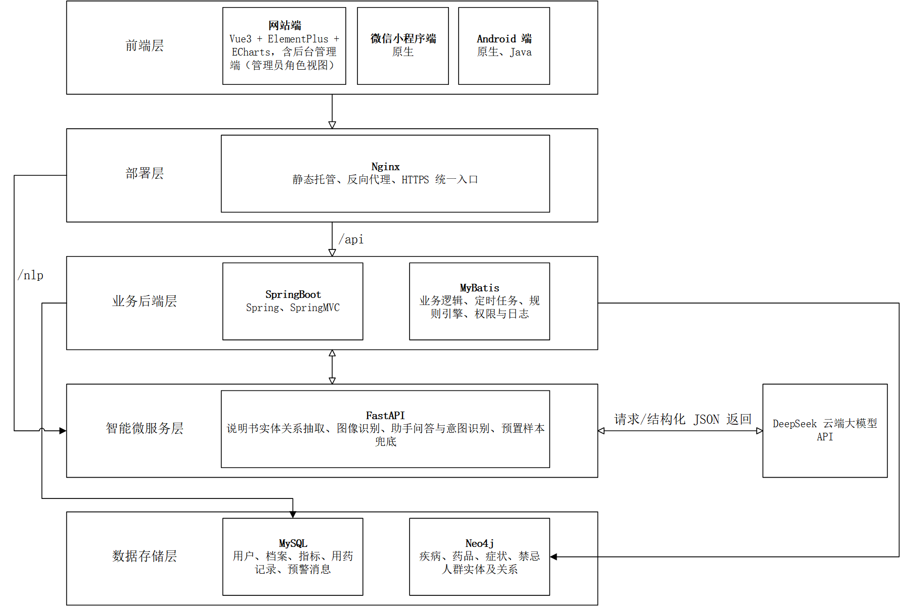

# 示例文档：文档规范演示

本文件演示 word-doc-pipeline 支持的 Markdown 子集与转换效果，可作为新文档的起点。复制本文件后修改标题与正文即可。

## 1 概述

**加粗文字**用于强调关键结论。正文一段一行，不要在段内手动换行；中文使用全角标点，数字与英文使用半角。

- 无序列表第一项
- 无序列表第二项

1. 有序步骤一
2. 有序步骤二

## 2 图表示例

**表 2-1 文档类型与产物**
| 文档类型 | 源文件 | 成品 |
| --- | --- | --- |
| 需求文档 | 需求文档.md | 需求文档.docx |
| 设计文档 | 设计文档.md | 设计文档.docx |

如图 2-1 所示，图片以嵌入式排版进入 Word，图注由脚本自动置于图片下方居中。

## 3 检查与交付

转换完成后执行文档校验命令，确认页面为 A4、页边距、页眉页码、图片与三线表均符合规范；再到 Word 中补齐封面、插入目录并更新域，最后另存 PDF。

---

以上为示例内容，正式文档中请删除本行及示例段落。
